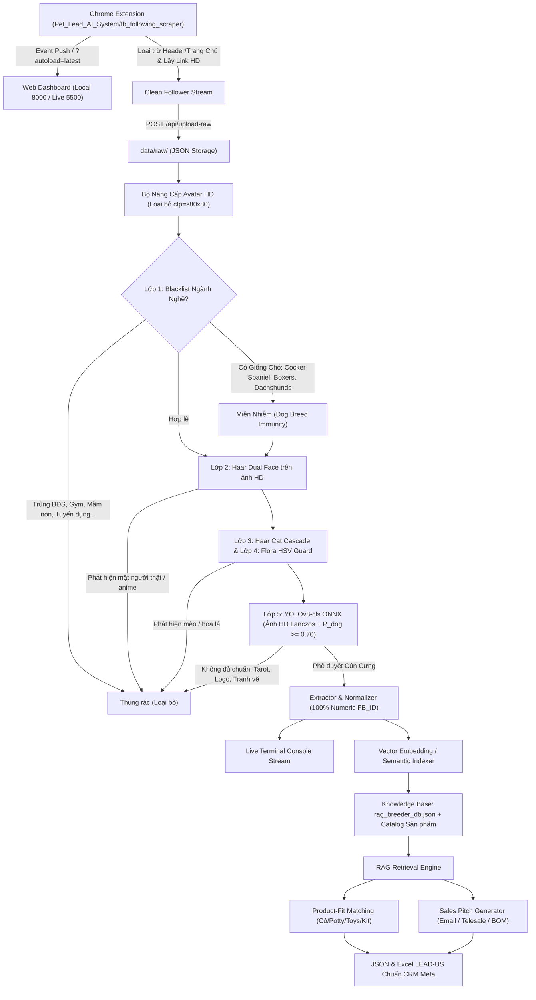

# KIẾN TRÚC RAG CHO HỆ THỐNG MARKETING PET & GRASS (v2.2)
> Mô hình Retrieval-Augmented Generation (RAG) phục vụ thẩm định hồ sơ, gợi ý sản phẩm phù hợp và sinh kịch bản Sales cá nhân hóa Song Ngữ (Trung - Việt).

---

## 1. MỤC TIÊU CỦA RAG TRONG DỰ ÁN

Trong hệ thống Marketing Pet & Grass, RAG không chỉ để "trả lời câu hỏi" mà đóng vai trò:
1. **Lọc dữ liệu đầu vào đa tầng (Multi-Stage Gatekeeper Quality):**
   - Áp dụng kiểm định 5 lớp: Lớp 1 (Blacklist ngành nghề phi thú cưng) $\rightarrow$ Lớp 2 (Haar Cascade Dual Face: ảnh thật + anime/minh họa loại trừ 100% mặt người) $\rightarrow$ Lớp 3 (Haar Cat Suppression) $\rightarrow$ Lớp 4 (HSV Flora Guard > 35% loại trừ hoa lá phong cảnh) $\rightarrow$ Lớp 5 (YOLOv8-cls ONNX $\ge 0.70$). Đảm bảo cơ sở dữ liệu hoàn toàn sạch, không bị ô nhiễm bởi các tài khoản người dùng cá nhân không phải là trại chó (Breeder).
2. **Luồng dữ liệu sự kiện tức thì (Event-Driven Stream Ingestion):**
   - Kết nối trực tiếp luồng cào từ Chrome Extension sang Web Dashboard qua `BroadcastChannel`, `GET /api/get-raw-file`, và URL parameter `?autoload=latest&raw_file=...`.
3. **Giám sát thời gian thực (Live Terminal Streaming Console):**
   - Truyền phát nhật ký phân tích từng dòng log với mã màu trực tiếp lên Terminal Console và giao diện Web, giúp quản trị viên kiểm soát lý do duyệt/bỏ từng hồ sơ.
4. **Truy xuất tri thức giống chó & đặc tính hành vi (Domain Retrieval):**
   - Từ giống chó được trích xuất (vd: *French Bulldog, Golden Retriever, Pomeranian, Shih Tzu*), RAG tự động truy xuất các thông số sinh học (mức độ rụng lông, nhu cầu vận động, kích cỡ khay vệ sinh, độ tuổi cắn gặm).
5. **Khớp sản phẩm thông minh (Product Matching):**
   - Giống chó nhỏ, nuôi căn hộ (Shih Tzu, Frenchie, Yorkie) $\rightarrow$ Khớp **Pet Potty Tray + Cỏ nhân tạo thấm hút nhanh + Đồ chơi gặm mini**.
   - Giống chó săn, cỡ lớn (Golden Retriever, Boykin Spaniel, Husky) $\rightarrow$ Khớp **Dog Turf sân vườn diện tích lớn + Đồ chơi gặm dẻo dai Tough Chew**.
6. **Cá nhân hóa kịch bản tiếp cận đa ngôn ngữ (Bilingual Personalized Outreach):**
   - Tự động sinh nội dung email / kịch bản Telesale chào bộ **Puppy Starter Kit V2/V3 in logo riêng** gửi cho đúng tên Chủ trại (`Owner / Representative`) bằng cả tiếng Anh, tiếng Việt và tiếng Trung.

---

## 2. DÒNG CHẢY DỮ LIỆU RAG (RAG PIPELINE WORKFLOW)

---

## 3. CƠ SỞ TRI THỨC TÍCH HỢP (KNOWLEDGE BASES)

1. `rag_breeder_db.json`: Cơ sở dữ liệu chứa thông tin giống chó chuẩn AKC, kích thước chuồng trại, hành vi mua sắm phụ kiện tại Mỹ.
2. `kit-dogv3.html`: Quy chuẩn kịch bản bán hàng theo 3 vòng tiếp cận (Day 0, Day 3, Day 5-7).
3. `Catalog Pet & Grass 2026`: Thông số kỹ thuật của Cỏ nhân tạo (thoát nước 60L/m2/phút), Khay Potty 3 lớp, Đồ chơi cao su an toàn không độc hại.
4. `LEAD_SCORING_CRITERIA.md`: Tiêu chí phân hạng Tier S (85-100đ), Tier A (70-84đ), Tier B (50-69đ).
5. `i18n_dictionary.json`: Từ điển thuật ngữ kỹ thuật Marketing B2B Song ngữ Trung - Việt chuẩn hóa cho các trường CRM.
